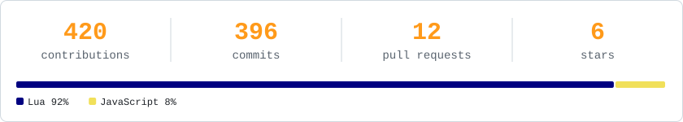

<picture>
  <source media="(prefers-color-scheme: dark)" srcset="assets/header-dark.svg">
  
</picture>

  
  
  
  
  
  

  
  

### Projects

<table>
<tr>
<td colspan="2" valign="top">

  
<a href="https://github.com/claykrs/multi-clawd"><b>multi-clawd</b></a>
 
One Claude Code chat leads a crew of agents working in parallel. Plus several Claude accounts side by side.
</td>
</tr>
<tr>
<td width="50%" valign="top">

  
<a href="https://github.com/claykrs/roblox-win98-emulator"><b>roblox-win98-emulator</b></a>
 
A 486 PC emulated in pure Luau. Boots real SeaBIOS, installs Windows 98 SE from the retail CD, and runs it in Roblox Studio.
</td>
<td width="50%" valign="top">

  
<a href="https://github.com/claykrs/roblox-win3-emulator"><b>roblox-win3-emulator</b></a>
 
An 8086/286 PC in pure Luau that boots the real Windows 3.0 to Program Manager. Complete.
</td>
</tr>
</table>

 

<picture>
  <source media="(prefers-color-scheme: dark)" srcset="assets/stats-dark.svg">
  
</picture>
